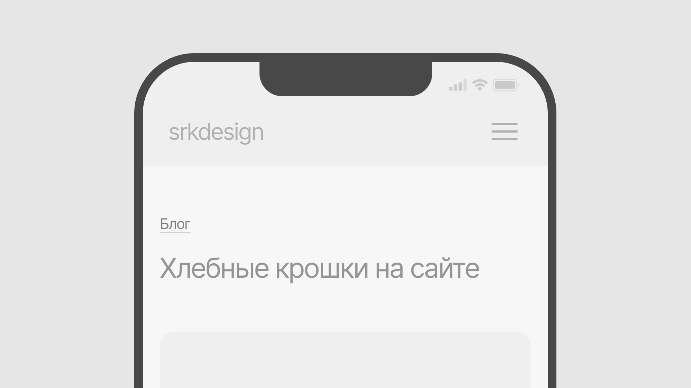
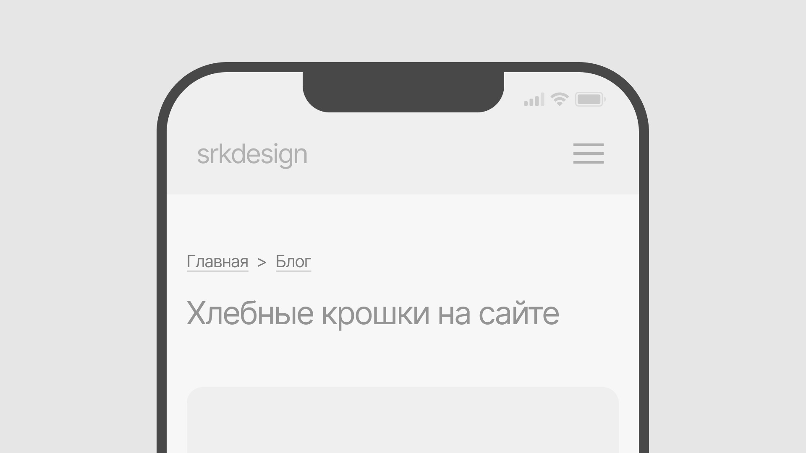
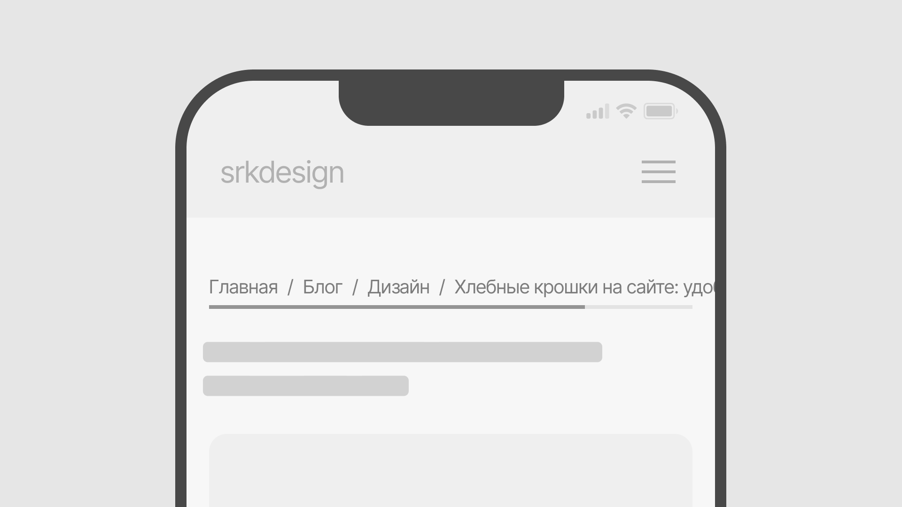
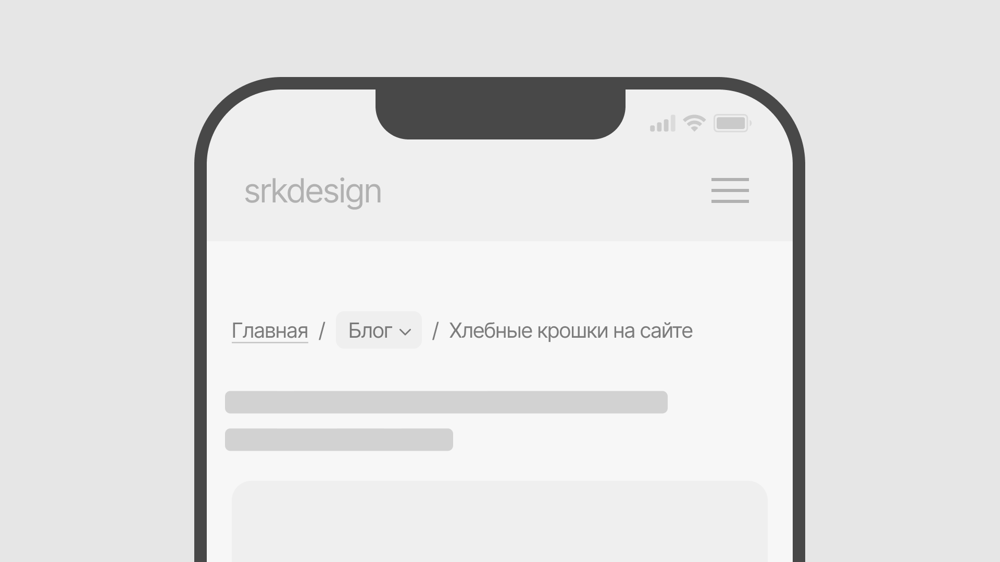

**Хлебные крошки** — элемент интерфейса, который облегчает навигацию на сайте. Показывает весь путь от главной страницы до текущей.

## Зачем нужны хлебные крошки

- **улучшают навигацию,** особенно когда на сайте много разделов (например, как в интернет магазине)
- **снижают показатель отказов,** позволяют вернуться назад без использования кнопок в браузере
- **повышают SEO,** поскольку поисковики используют структуру хлебных крошек для построения сниппета сайта


*Все ссылки кроме той, что ссылается на текущую страницу кликабельные*

> [!hint] Читайте далее
> Подробнее о поисковиках и SEO-оптимизации читайте в статье: [SEO для разработчиков: как оптимизировать код и сайт](../seo-for-developers/index.mdx)

## Какими должны быть хлебные крошки?

- простыми и предсказуемыми
- удобными на всех устройствах (в том числе и мобильных)
- минималистичными (не нужно перегружать интерфейс лишними элементами или стилями)
- визуально аккуратными

### Требования к дизайну

- размер шрифта не менее 14px
- отступ между крошками не меньше 0.5rem (8px)
- цвет по контрасту минимум 4.5:1



*Можно сократить хлебные крошки на мобильных до последнего уровня (1/2)*

## Принципы удобных хлебных крошек

1. Стандартное расположение: под шапкой сайта и над заголовком страницы
2. Не прячьте хлебные крошки — иначе они теряют смысл
3. Каждый элемент цепочки должен быть кликабельным, кроме последнего
4. Чтобы избежать путаницы, лишних кликов и улучшить доступность для экранных читалок, текущую страницу в цепочке лучше не оформлять ссылкой
5. Предыдущая страница всегда должна быть видна
6. Текущую страницу можно не указывать в хлебных крошках, если сразу после идет заголовок
7. Все элементы должны вести туда, где пользователь ожидает оказаться
8. Разделитель должен указывать направо (в LTR интерфейсах) и быть привычным для пользователя



*Можно не указывать ссылку на текущую страницу, если сразу после хлебных крошек идет заголовок этой страницы*

Если крошки ведут на неочевидные страницы, или последняя страница ссылается на ту же страницу — пользователь теряется. Появляется фрустрация: интерфейс не помогает, а мешает. Пропадает доверие к сайту. Снижается вовлеченность и время проведенное на странице, возрастает показатель отказов — что напрямую влияет на SEO.

```markdown title="Привычные разделители хлебных крошек"
> / →
```

## Дизайн хлебных крошек на мобильных

### Нельзя

1. **Растягивать хлебные крошки на несколько строк** — это усложняет восприятие и перегружает интерфейс
2. **Делать хлебные крошки и другие кликабельные элементы меньше минимума для сенсорных экранов — 1х1 см** (Google рекомендует минимальный *tap target* **48x48 px**)
3. **Скрывать хлебные крошки на мобильных, но оставлять их на десктопе** — рискованно в точки зрения SEO, может привести к проблемам индексации сайта из-за скрытия контента от пользователя (cloaking)
4. **Использовать аккордеоны или динамическую подгрузку** для крошек — для SEO весь путь должен быть виден в HTML

### Можно

1. **Сокращать хлебные крошки до последнего уровня** (при условии, что весь путь остается в коде)
2. **Реализовать горизонтальный скролл** для длинных крошек, не обрезая контент — главное, чтобы скролл был очевидным и интуитивным
3. **Частично заменить навигацию по хлебным крошкам выпадающим меню при клике** (при условии что структура сохраняется в коде и доступна поисковикам)
4. **Реализовать свайп-жест для прокрутки** хлебных крошек на мобильных


*Можно сократить хлебные крошки на мобильных до последнего уровня (2/2)*



*Показывая хлебные крошки с помощью горизонтального скролла обязательно добавьте индикатор прокрутки*




*Пример выпадающего меню в хлебных крошках*

## Источники

1. [Nielsen Norman Group (Page Laubheimer)](https://www.nngroup.com/articles/breadcrumbs/)
2. [Interaction Design Foundation](https://www.interaction-design.org/literature/article/mobile-breadcrumbs?srsltid=AfmBOoojXH5zx1kV4aP2OKlezZ2g7MlBI4nUSMVYfY5zpEfdxH78mlSa#types_of_mobile_breadcrumbs-1)
3. [The Good](https://thegood.com/insights/mobile-breadcrumbs/)
4. [Smashing Magazine](https://www.smashingmagazine.com/2022/04/breadcrumbs-ux-design/)
5. [Search Engine Land](https://searchengineland.com/breadcrumb-seo-best-practices-383690)
