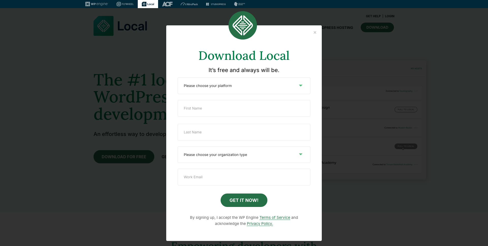
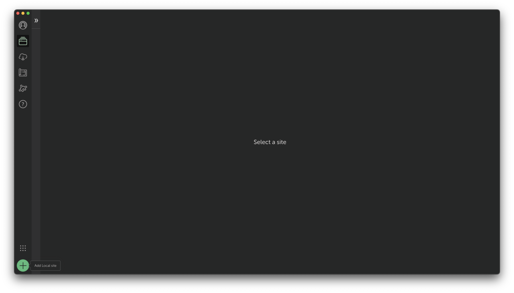
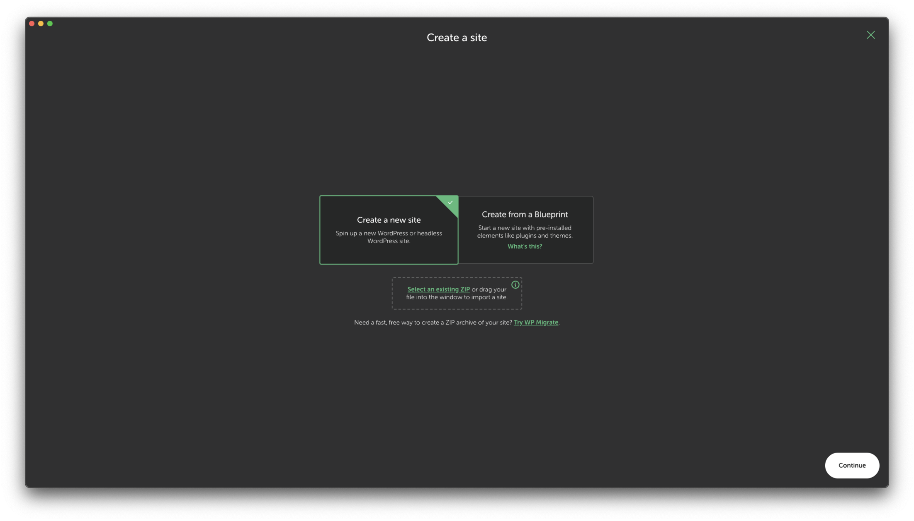
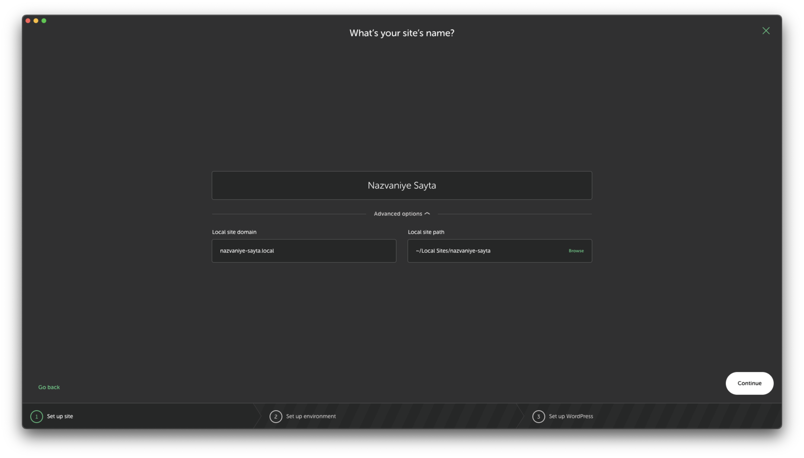
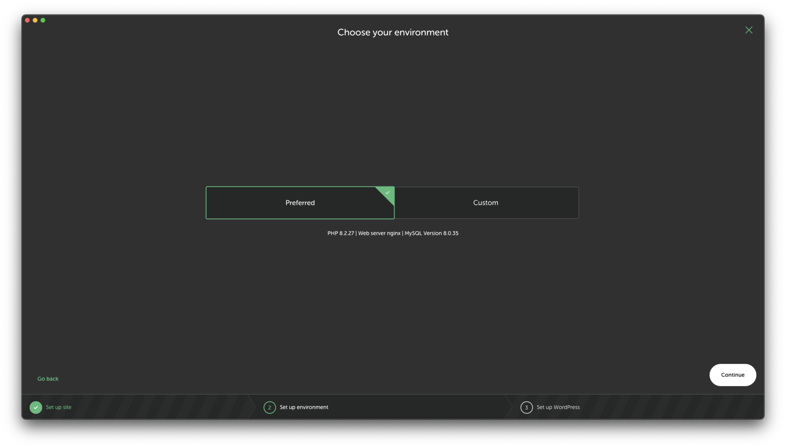
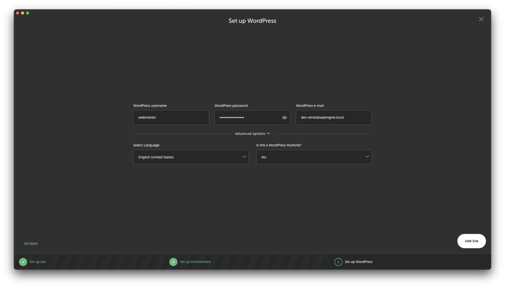

import Table from "@components/Markdown/Table.astro";

Wordpress -- это платформа для создания сайтов, где все управление контентом происходит через админ-панель. Wordpress облегчает пользовательский опыт и сокращает сроки разработки сайта.

## Для чего нужна локальная установка

- разработки собственных плагинов
- создания тем оформления
- поиска багов и ошибок на сайте (WP_DEBUG)
- безопасного тестирования, экспериментов с кодом и плагинами
- бекапов сайта с хостинга

## Варианты установки и их преимущества

Установить Wordpress локально можно с помощью сразу нескольких программ:

### LocalWP

export const localwp = [
  {
    pros: [
      "легкая установка",
      "понятный интерфейс",
      "не нужно настраивать базы данных и phpMyAdmin вручную",
      "автоматически подписывает SSL сертификаты",
      "управление сразу несколькими сайтами",
      "есть возможность клонирования и экспорта сайтов",
      "поддерживает Windows, MacOS и Linux",
    ],
    cons: ["ограниченная настройка", "требует больше ресурсов"],
  },
];

<Table
  headers={["Преимущества", "Недостатки"]}
  data={localwp}
  keys={["pros", "cons"]}
/>

Поскольку LocalWP поддерживает все платформы дальше речь пойдет именно о нем.

### Wampserver

export const wampserver = [
  {
    pros: ["можно полностью подстроить сервер под текущий проект"],
    cons: [
      "предлагает скачать сразу несколько программ во время установки",
      "требует настройки баз данных и phpMyAdmin",
    ],
  },
];

<Table
  headers={["Преимущества", "Недостатки"]}
  data={wampserver}
  keys={["pros", "cons"]}
/>

### Openserver

export const openserver = [
  {
    pros: [
      "легкая установка",
      "контроль над всеми компонентами сервера",
      "полностью поддерживает MariaDB",
      "несколько версий PHP/MySQL",
      "виртуальные хосты",
      "полностью бесплатный",
    ],
    cons: [
      "настройка требует больше времени чем LocalWP",
      "интерфейс может показаться сложным",
      "обновления компонентов могут приходить не сразу",
    ],
  },
];

<Table
  headers={["Преимущества", "Недостатки"]}
  data={openserver}
  keys={["pros", "cons"]}
/>

### MAMP

export const mamp = [
  {
    pros: ["понятный интерфейс", "поддерживает Windows и MacOS"],
    cons: [
      "для расширенных функций нужна платная версия",
      "требует настройки баз данных и phpMyAdmin",
    ],
  },
];

<Table
  headers={["Преимущества", "Недостатки"]}
  data={mamp}
  keys={["pros", "cons"]}
/>

## Установка Local WP

1. Перейдите на сайт [localwp.com](https://localwp.com)
2. Нажмите на кнопку "Download For Free" и заполните данные во всплавающем окне
3. После заполнения данных нажмите на кнопку "Get it now"
4. Дождитесь загрузки установщика и следуйте инструкциям после его запуска

## Создание сайта LocalWP

1. Запустите LocalWP
2. Нажмите на кнопку с плюсом в левом нижнем углу экрана

*Нажмите на кнопку + в левом нижнем углу*

3. Если хотите создать сайт с 0, выберите "Create new site" (Создать новый сайт) и нажмите "Continue" (Продолжить)
4. _(Опционально) Если хотите запустить локально бекап сайта, выберите ZIP файл и перетащите его в прямоугольник с обводкой_

*Выберите какой сайт хотите создать: с нуля или из .zip файла*

5. **Настройка сайта.** Выберите название для сайта, из которого автоматически будет создан домен для вашего сайта (который можно ввести и вручную). Выберите путь к вашему сайта на диске (может быть абсолютно любая папка, по умолчанию это Local Sites)

*Название сайта обязательно нужно указывать латинскими буквами*

6. **Настройка среды.** В разделе "Custom" вы можете настроить PHP версию, web сервер (Apache или Nginix) и базу данных. Если вам это не важно, можете оставить версии по умолчанию, выбрав "Preferred"

*Настройка среда Wordpress во время создания сайта с LocalWP. Если не знаете, что это, лучше оставить значения по умолчанию*

7. **Настройка Wordpress.** В этом разделе вам будет предложено ввести логин и пароль администратора Wordpress, выбрать язык сайта

*Настройка Wordpress во время создания сайта с LocalWP*

> [!hint] Читать далее
> Больше статей о дизайне и разработке сайтов на Wordpress читайте в блоге.

## Источники

1. [How I built a super fast minimal WordPress blog](https://youtu.be/oS7IVUwQniM)
2. [LocalWP](https://localwp.com)
