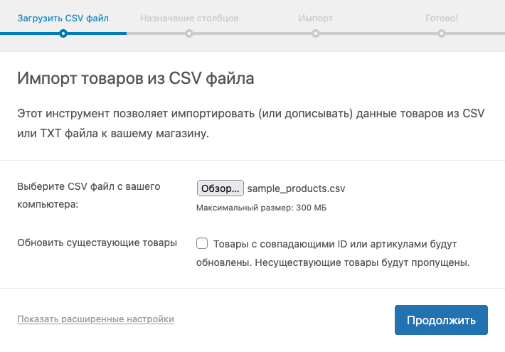
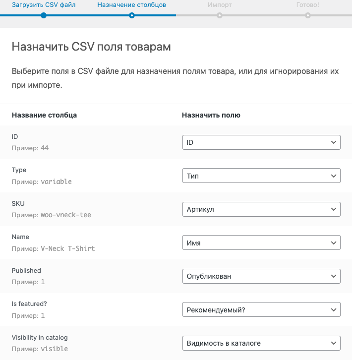
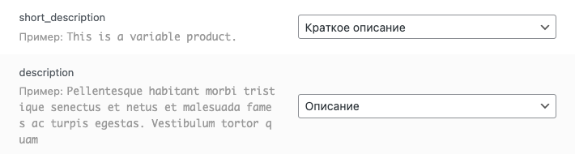
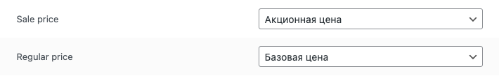
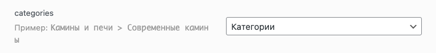
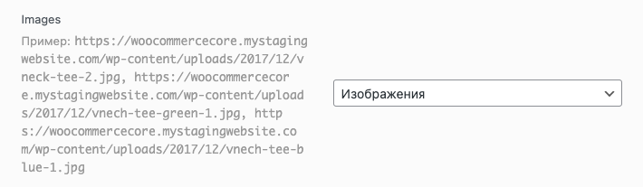
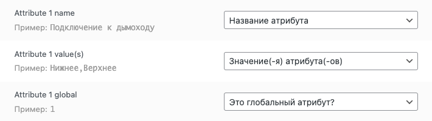
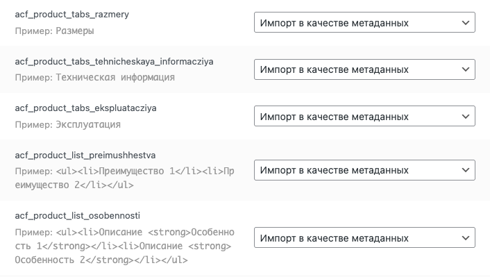
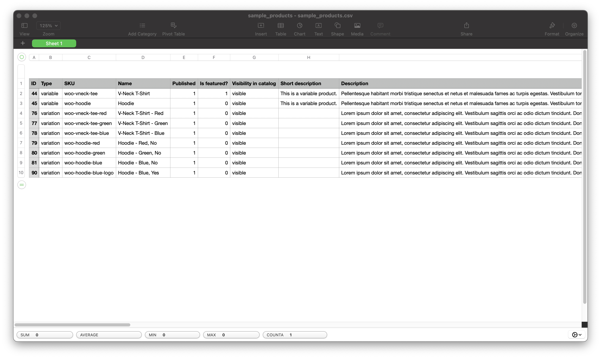

import Table from "@components/Markdown/Table.astro";

Существует множество как платных, так и бесплатных плагинов для импорта товаров. Самый надежный из них — встроенная утилита для импорта от самого WooCommerce. О ней и пойдет речь в статье.

Процесс импорта состоит из 2 этапов: загрузки файла с данными о товарах и назначения значений для столбцов файла.

## Подготовка файла с товарами для импорта

Импортировать товары в WooCommerce можно из файлов 2-х типов: CSV и XLSX.
Если XLSX это не нуждающийся в особом представлении, общеизвестный формат электронных таблиц, то CSV — менее распространенный формат, который переводится как "значения, разделенные запятыми".

В CSV файле, строки — это ряды, а значения разделенные запятыми — столбцы таблицы. На 1-ой строке через запятую пишутся заголовки столбцов (цена, категории, название). Каждая следующая строка будет обозначать новый товар, все значения которого также перечисляются через запятую. Выглядит это примерно так:

```csv
1 name,price,description
2 "Деревянная полка ручной работы","10000","Полка ручной работы из массива дуба с уникальным рисунком"
```

### Общие практики подготовки CSV файла к импорту

Дальше будут приведены общие практики подготовки CSV файла к импорту. В статье охвачены все основные поля, необходимые для запуска интернет-магазина. За инструкциями к определенным полям переходите на соответствующий раздел этой статьи.

- любое значение нужно оборачивать в кавычки, лучше двойные ""
- если вы у товара нет какого-либо значения — пишите пустые кавычки ""
- следите за тем, чтобы на каждой строке было одинаковое количество запятых
- перепроверяйте CSV файл перед импортом визуально, на наличие съехавших значений и опечаток в названиях столбцов с помощью Microsoft Excel, Google Sheets или Numbers
- чтобы не назначать тип каждого столбца при импорте вручную, укажите правильные заголовки в файле

### Правильные заголовки для импорта товаров

Под "правильными заголовками" подразумеваются те заголовки, которые WooCommerce может распознать самостоятельно. Все заголовки были взяты из официальной документации WooCommerce или выявлены самостоятельно при импорте товаров.

export const items = [
  {
    type: "sku",
    meaning: "Артикул (для вариативных товаров)",
  },
  {
    type: "title, name",
    meaning: "Название",
  },
  {
    type: "categories",
    meaning: "Категория (-и)",
  },
  {
    type: "images",
    meaning:
      "Галерея изображений товара (где 1-ое значение — миниатюра товара)",
  },
  {
    type: "type",
    meaning: "Тип товара (может быть: simple, variable, variation)",
  },
  {
    type: "id",
    meaning: "Цифровое значение (номер) товара",
  },
  {
    type: "description",
    meaning: "Длинное описание",
  },
  {
    type: "short_description",
    meaning: "Короткое описание",
  },
  {
    type: "In Stock?",
    meaning: "Наличие товара",
  },
  {
    type: "regular_price",
    meaning: "Стоимость товара",
  },
  {
    type: "parent",
    meaning: "Родительский товар (для вариативных товаров)",
  },
  {
    type: "Attribute 1 name",
    meaning: "Название атрибута (где 1 — это порядковый номер атрибута)",
  },
  {
    type: "Attribute 1 global",
    meaning: "Является ли атрибут глобальным? (для фильтрации товаров)",
  },
  {
    type: "Attribute 1 value(s)",
    meaning: "Значение (-я) атрибута",
  },
];

<Table
  headers={["Заголовок", "Значение"]}
  data={items}
  keys={["type", "meaning"]}
/>

> [!tip] Можно ли прописать заголовки без подчеркиваний вместо пробелов?
> Да, можно, но это рабоатет далеко не со всеми значениями (например, с наличием или атрибутами). В документации Woocommerce и файлах с тестовыми данными для импорта используются как версии с подчеркиваниями, так и версии с заглавными буквами и пробелами.

## Назначение значений столбцов при импорте

Чтобы импортировать товары из файла, перейдите в раздел `Товары - Добавить новый - Импорт` в панели администратора WordPress.



После выбора файла, вам предложат выбрать или отредактировать значения каждого столбца в файле с примерами. Если WooCommerce не смог определить к какому полю относится столбец, он напишет что-то вроде "Не импортировать" и вам придется выбрать тип вручную.



Как только выберите тип для всех столбцов, нажмите на кнопку "Запустить инструмент импорта" и перед вами появится шкала прогресса. Как только импорт завершится, перед вами появится окно с указанием количества и вариаций загруженных товаров.

## Описание товара

Описание товара может быть коротким или обычным. Короткое описание обычно не больше 2-3 предложений.

Обычное описание прописывается в CSV файле с помощью заголовка `description`, в то время как короткое — через заголовок `short_description`.



## Цена

Цена товара в WooCommerce бывает 2-х типов: обычная цена и акционная цена.

Обычная цена прописывается в файле через заголовок `regular_price`, а акционная — `sale_price`.



## Категории

Существуют категории 1-го, 2-го, 3-го и т.д. порядка. Категория 1-го порядка обычно называется просто "категория", а все остальные — "подкатегориями".

Указать категорию товара в CSV файле можно просто написав ее название в кавычках для соответствующего столбца. Для того чтобы указать подкатегорию товара (т. е. показать вложенность категорий), нужно прописать все категории от 1-го до последнего порядка через специальный символ `>`.

```csv
"Полки>Полки из дерева>Полки из дерева ручной работы"
```



## Галерея товаров

Чтобы импортировать несколько изображений, достаточно прописать "images" в заголовке CSV файла или заголовке колонки в xlsx файле.

Сами файлы, а точнее ссылки на них, указываем через запятую.

> [!hint] Как указать изображения через запятую в csv?
> В CSV файле запятые — это разделители значений. Поэтому, просто указать ссылки через запятую мы не можем.
>
> Сначала, нам нужно обернуть наше значение в кавычки (""). После чего, прописываем все ссылки внутри кавычек через запятую.
>
> 1-е указанное изображение загрузится как "Изображение товара", а все последующие как изображения в "Галерее товара".

После загрузки вашего файла в импортер WooCommerce, тип для поля выберется автоматически. Если нет, откройте выпадающий список и выберите раздел "Изображения".



## Атрибуты товара

Импорт атрибутов по своей сути сложнее всех остальных. Обусловлено это тем, что у атрибутов есть название и значение. Таким образом, вместо 1-го поля придется прописывать сразу 2. Помимо этого, у этих полей должны быть особые названия.

По документации WooCommerce, для названия атрибута принято указывать **Attribute 1 name**, а для значений **Attribute 1 value(s)**. Где 1 является порядковым номером атрибута (1-ый импортируемый атрибут, 2-ой, 3-ий и т.д.)

Значения атрибута, так же, как и другие поля в CSV или XLSX файле оборачиваются кавычками. Для перечисления нескольких значений атрибута, каждое значение разделяется соответствующим символом |.

При данном подходе, тип поля будет автоматически подобран самим WooCommerce при импорте. Однако, если это не случилось, можете выбрать их самостоятельно из предложенного списка, где **Attribute 1 name** — это "Название атрибута", а **Attribute 1 value(s)** — "Значение(-я) атрибута(-ов)".

Чтобы сделать атрибут глобальным, в колонке **Attribute 1 global** указываем 1.



## Персонализированные (ACF) поля

ACF поля могут быть разных типов - текстовая строка, редактор или изображение. Чтобы импортировать их, нужно обязательно указать ключи всех полей в заголовке CSV или XLSX файла, и заполнить значения для них в самих товарах.

После чего, при импорте файла с помощью встроенной утилиты WooCommerce, выберите "Импортировать как метаданные" и все будет импортировано.

Я обычно приписываю ко всем полям приставку `acf` для удобства.



## Импорт вариативных товаров

В вариативных товарах можно выбрать определенный товар по атрибутам. Для этого обязательно прописываем везде артикул и тип товара.

- У родительского товара указываем тип `variable`, а у дочерних товаров тип `variation`
- В дочерних товарах ссылаемся на родительский по артикулу `(sku)`
- Атрибут указываем 2-мя полями: 1-е название атрибута `(Attribute 1 name)`, 2-е его значения `(Attribute 1 value(s))`
- Значения атрибута обязательно оборачиваем в кавычки и внутри них указываем через запятую
- Если хотим в дальнейшем фильтровать товар по атрибуту, указываем его как глобальный `(Attribute 1 global)`

> [!hint] Фильтрация товаров в WooCommerce
> Подробнее о фильтрации товаров сможете прочитать в следующей статье.

## Бонус. Готовый CSV для импорта товаров

Ниже прикреплена отредактированная для импорта вариативных товаров версия официального демо-файла от Woocommerce. Для тех, кто хочет понять принцип устройства вариативных товаров или атрибутов на реальном примере, чтобы избежать ошибок при загрузке товаров.



*Скачать файл с примерами вариативных товаров: https://docs.google.com/spreadsheets/d/1tTivgs4n_h55_WJc_VXupNnLEXWm2Mpu12kXaRNclto/edit?usp=sharing*

## Источники

1. [How to import WooCommerce products: A comprehensive guide for store owners](https://www.hostinger.com/tutorials/how-to-import-woocommerce-products)
2. [How To Import Products In To WooCommerce Using a CSV Spreadsheet | Bulk Import Products In To WooCom](https://youtu.be/V4TFvmEuPdE?list=LL)
3. [Product CSV Importer and Exporter](https://woocommerce.com/document/product-csv-importer-exporter/#import)
