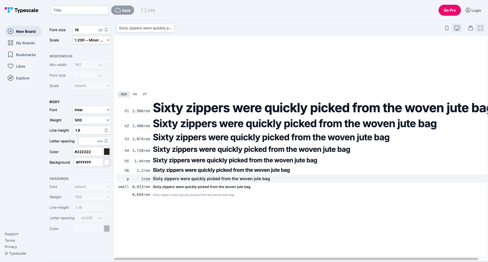
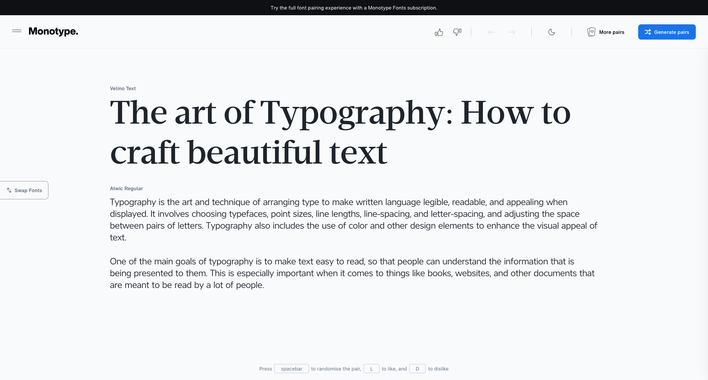
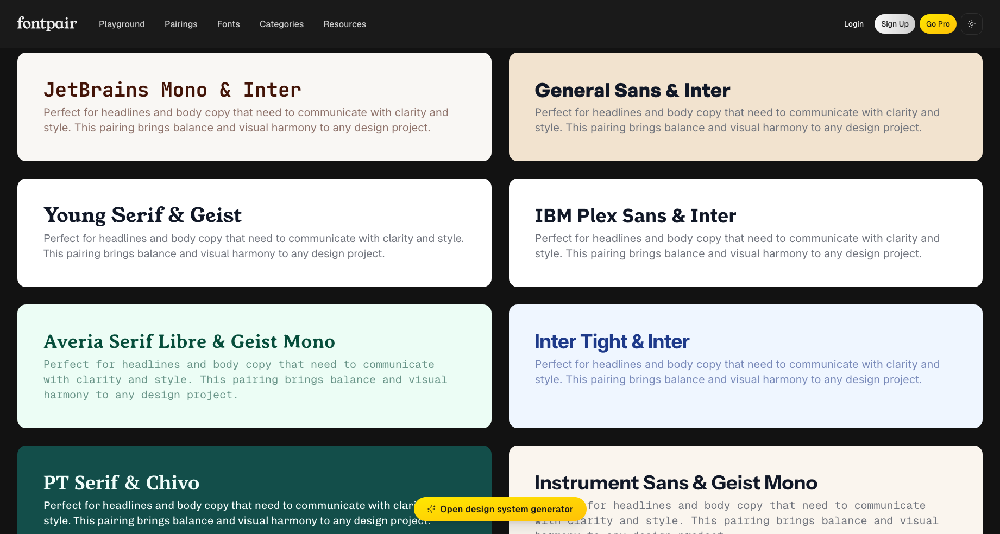
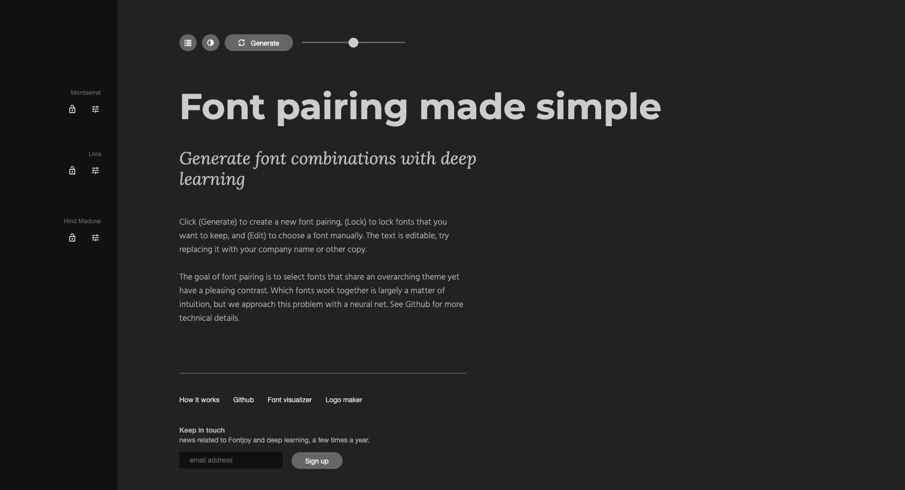
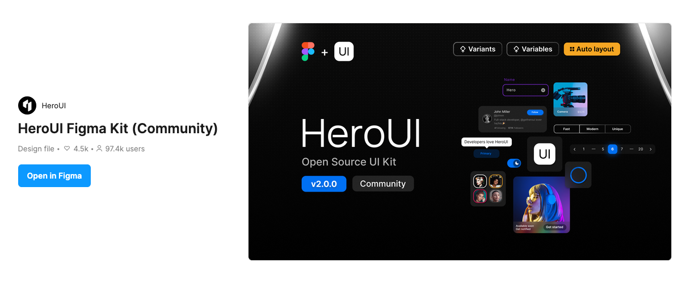
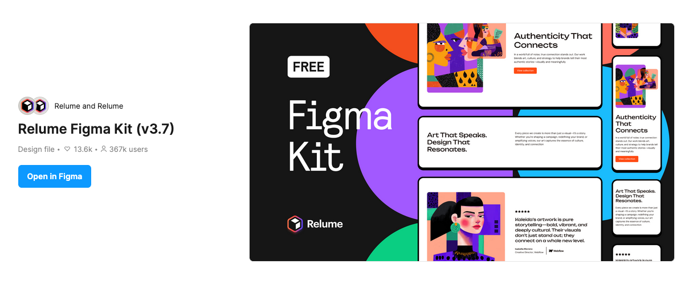
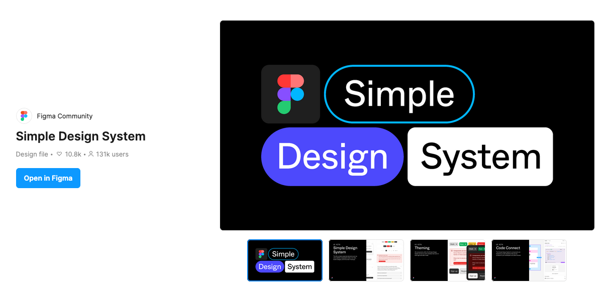
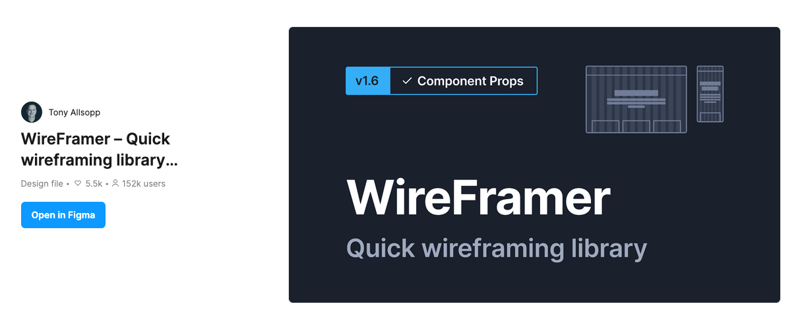
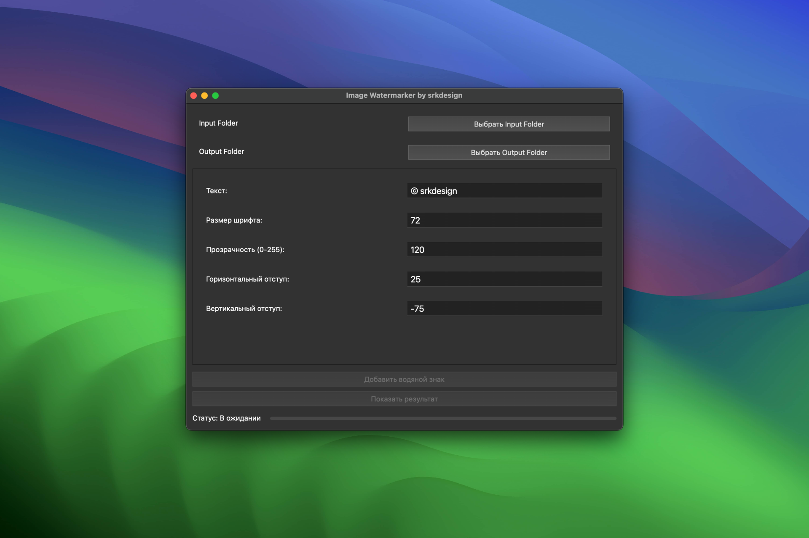

В работе над макетами сайтов больше всего времени уходит не на креатив, а на рутинные задачи, например, подбор шрифтов, создание равномерных отступов у кнопок или выравнивание блоков.

Чтобы освободить больше времени для творчества, стоит автоматизировать повторяющиеся процессы и использовать инструменты, которые помогают ускорить рутинную работу.

## Типографика

### Создание типографической системы

Создание типографической системы не только снизит когнитивную нагрузку при работе над проектом, но и сэкономит время. Поскольку, текст, в различных своих проявлениях, будь то обычный параграф или заголовок — это самый часто повторяющийся элемент на сайте.

[Typescale](https://typescale.com) — сайт, с помощью которого можно создать готовую типографической систему для проекта за пару минут.

> [!hint] Подсказка
> Тот самый случай, когда лучше потратить 5 минут в начале проекта, чтобы в дальнейшем сэкономить значительно больше времени.

### Подбор шрифтовых пар

Иногда, можно часами подбирать шрифт для проекта и так и не найти подходящего. В подборе шрифтов могут помочь такие сервисы как [FontJoy](https://fontjoy.com), [FontPair](https://www.fontpair.co) и [Monotype](https://www.monotype.com/font-pairing#/).

*В monotype можно выбрать сразу оба шрифта: для заголовков и основного текста.*

*Fontpair предоставляет подборка готовых шрифтовых пар из бесплатных шрифтов, подойдет на старте и для коммерческих проектов.*

Как и на сайте monotype, можно выбрать и поменять сразу как шрифт заголовков, так и основного текста.

## Библиотеки блоков

> [!hint] Подсказка
> С помощью библиотек блоков можно собрать прототип всего за несколько часов, вместо того чтобы тратить дни на отрисовку всего с нуля.

Такой подход экономит время и позволяет сосредоточиться на идеях и деталях, а не на повторяющейся работе.

### Готовые решения

В Figma Community можно найти множество готовых библиотек блоков и компонентов под самые разные задачи. Использование таких библиотек помогает быстро начать проект или искать идеи, особенно когда нужно вдохновение или проверенные шаблоны.

[HeroUI](https://www.figma.com/community/file/1267584376234254760) (ранее NextUI) — это библиотека одноимённых React‑компонентов с соответствующим файлом Figma. Отличный источник готовых элементов интерфейса: различные типы инпутов, кнопки, а также бейджи, табы и другие UI‑компоненты, которые удобно использовать в прототипах и макетах.

[Relume Kit](https://www.figma.com/community/file/1078092050664989246) — в отличие от HeroUI, фокусируется не на отдельных элементах, а на целых блоках и даже страницах. Компоненты легко редактировать и персонализировать. Сами блоки по структуре варьируются от стандартных до креативных.

[Simple Design System](https://www.figma.com/community/file/1380235722331273046) — подборка компонентов от самой Figma. Поможет легко начать новый проект.

[Wireframer](https://www.figma.com/community/file/1101637212272928503) — нестандартная подборка готовых решений. Есть как привычные UI-элементы, так и компоненты для составления стайлгайдов, сетки и иконки.

### Создание своей библиотеки

У каждого дизайнера со временем накапливается набор блоков, которые впоследствии можно использовать как шаблоны. Чтобы работать максимально эффективно, стоит создать отдельный файл с часто повторяющимися блоками и использовать его как основу для новых проектов.

Преимущество такого подхода в том, что все блоки создаются вами лично: они выдержаны в едином стиле и уже адаптированы под ваш тип и особенности работы, что экономит время и обеспечивает консистентность дизайна.

## Программы

[Image Watermarker](https://srkdesign.pro/apps/image-watermarker/) — программа для автоматического добавления водяных знаков ускоряет работу с изображениями и упрощает процесс их подготовки, оставляя больше времени на основной дизайн.

[Website Calculator](https://srkdesign.pro/apps/website-calculator/) — программа автоматически формирует Excel-файл с расчетом стоимости создания сайта в аккуратном и структурированном виде, избавляя от необходимости создавать и настраивать таблицу вручную.

[Upscayl](https://upscayl.org) — ИИ-программа для апскейла изображений без временных и токен-ограничений позволяет обрабатывать фотографии в нужном объеме и темпе, без пауз и дополнительных лимитов.

Приложение для автоматизации добавления водяных знаков можно скачать по ссылке: https://srkdesign.pro/apps/image-watermarker/

## Поиск вдохновения

Как и с подбором шрифтов, искать подходящие референсы для проекта можно часами. Чтобы ускорить поиск и повысить качество референсов, нужно искать их на площадках помимо классических Awwwards, Behance, Dribbble и Pinterest.

> [!hint] Подсказка
> Более 30 качественных сайтов для поиска вдохновения были собраны в лаконичные подборки: [Где брать вдохновение дизайнеру?](../designers-search-for-inspiration/index.md) и [Полезные ресурсы для дизайна и разработки](../useful-tools-for-webdesign-and-development/index.md)
